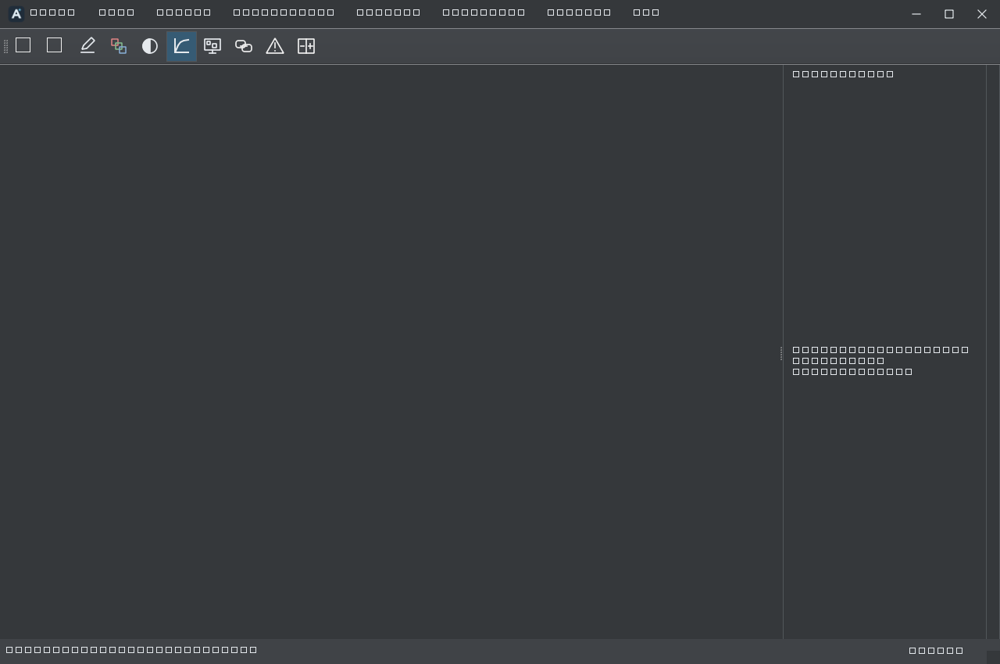

# Astra

Astra — настольная программа для сложения и обработки астрофотографий под Windows. Объединяет подготовку кадров, сложение и дальнейшую обработку изображения в одном рабочем пространстве.

## Возможности

- Калибровка кадров с использованием Dark, Flat и Dark Flat.
- Совмещение и сложение, отбраковка выбросов и Drizzle.
- Работа с FITS, XISF, TIFF и RAW-файлами фотоаппаратов.
- Растяжение, кривые, коррекция фона и работа с цветовыми палитрами.
- Маски, отделение звёзд и ретушь.
- Астрометрическое решение и аннотации.
- История обработки, контрольные точки и сохранение проектов.
- Подключение GraXpert, StarNet, ASTAP и инструментов RC-Astro.
- Дополнительное ускорение отдельных вычислений на NVIDIA GPU.

## Установка и запуск

Текущая версия: **1.1.4**.

Готовая portable-сборка предназначена для Windows 10/11 x64. Распакуйте архив полностью и запустите `Astra.exe`.

Python и основные зависимости включены в portable-сборку. Внешние инструменты, ИИ-модели и CUDA устанавливаются отдельно. Для продуктов RC-Astro требуется соответствующая лицензия.

## Запуск из исходников

Установите Python, выполните `install.bat`, затем запустите `start.bat`.

## Язык интерфейса

Русский и английский доступны в настройках программы. После изменения языка перезапустите Astra.

## Обратная связь

Сообщайте об ошибках и предлагайте улучшения через Issues. В сообщении укажите версию Astra, последовательность действий и приложите журнал или снимок экрана.

## Для разработчиков

Подробности реализации, ограничения и заметки по проверкам находятся в [DEVELOPMENT_NOTES.md](DEVELOPMENT_NOTES.md).
